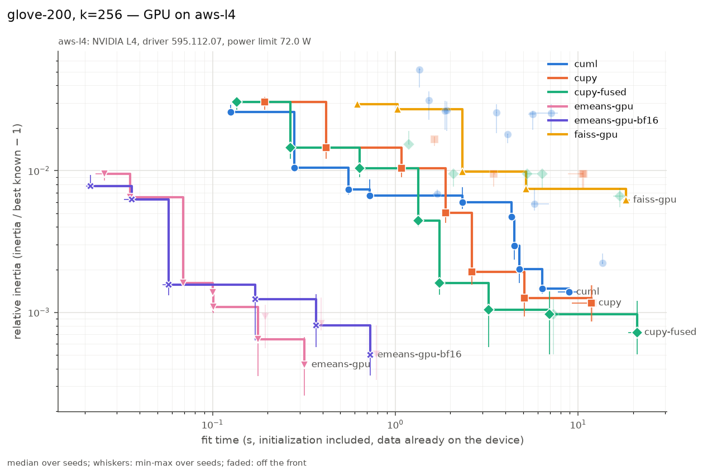
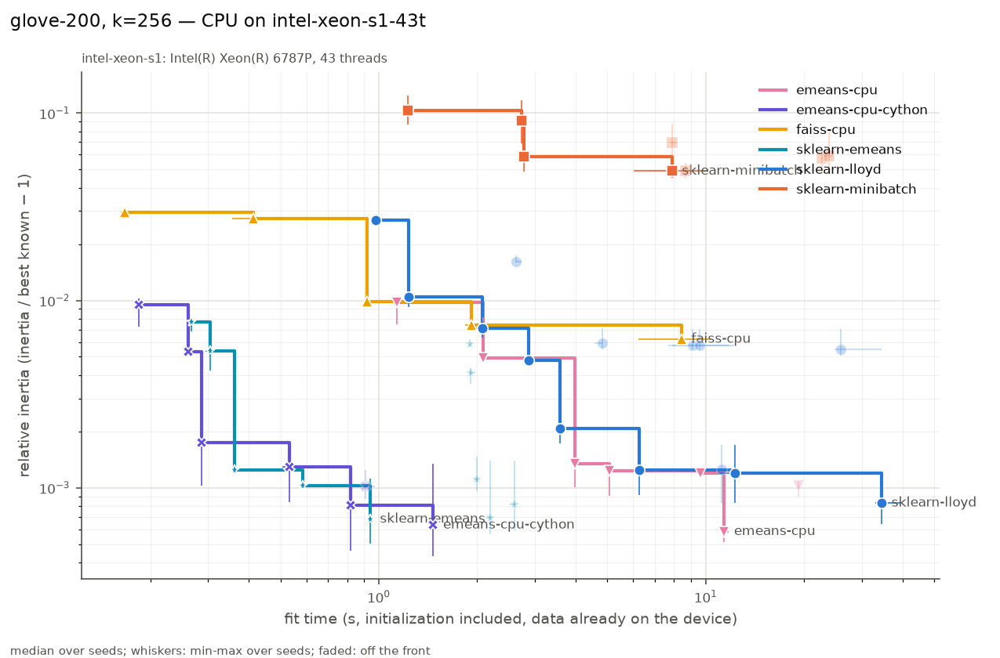

# kmeans-benchmarks

What [ann-benchmarks](https://github.com/erikbern/ann-benchmarks) does for nearest-neighbor
search, for k-means: **for a given time budget, which implementation and settings give the
lowest inertia?** Each figure plots fit time (log x) against relative inertia (log y) for one
dataset, one k and one piece of hardware, with one Pareto front per implementation.
Lower-left is better.

The context and the requirements are in [PROMPT.md](PROMPT.md). The pilot results are
[below](#pilot-results-glove-200-k256).

## Quickstart (a few minutes, any Linux machine)

```bash
pixi install -e cpu                                   # scikit-learn nightly, FAISS 1.16 CPU
pixi run build-ext                                    # the e-means CPU kernel (Cython, OpenMP)
pixi install -e sklearn-emeans                        # scikit-learn with EMeans, built from source
pixi run python -m kmb data year-msd                  # downloads 211 MB, writes data/year-msd.npy
pixi run python -m kmb run configs/quickstart.toml    # 16 jobs, 48 fits, ~1 min on a laptop
pixi run python -m kmb plot                           # plots/<dataset>-k<k>-<machine>-<device>.png
```

To run a single implementation on a single dataset, write a config with one entry under
`[impls]`, or filter an existing one:

```bash
pixi run python -m kmb list                           # implementations and their defaults
pixi run python -m kmb run configs/pilot-glove-k256-gpu.toml --impl cuml --dry-run
```

**Always run timed work under `benchlock`** (see the machine notes in `~/.claude/CLAUDE.md`):
CPU benchmarks on one socket of intel-xeon, GPU benchmarks on an AWS L4 VM.

```bash
# CPU, one socket of intel-xeon (86 cores; the configs set threads = 43)
ssh intel-xeon 'cd ~/work/kmeans-benchmarks && benchlock --tag "kmb cpu" s1 -- \
  pixi run python -m kmb run configs/pilot-glove-k256-cpu.toml --machine intel-xeon-s1'
# GPU, a whole L4 VM
ssh aws-l4-2 'bash -lc "cd ~/work/kmeans-benchmarks && benchlock --tag \"kmb gpu\" all -- \
  pixi run python -m kmb run configs/pilot-glove-k256-gpu.toml --machine aws-l4"'
```

Then copy `results/*.jsonl` back and run `python -m kmb plot`.

## How it works

```
configs/*.toml ──> runner (python -m kmb run) ──> one subprocess per job:
                    expands the grids,               pixi run -e <env> python -m kmb.worker
                    interleaves the implementations,    import, load .npy, copy to device,
                    skips fits already done,            warm-up fit, then for each seed:
                    prints an ETA                       time fit → score centers → append JSON line
                                                   ──> results/<config name>.jsonl
python -m kmb plot ──> plots/<dataset>-k<k>-<machine>-<device>.{png,csv}
```

- **One pixi environment per library** (their CUDA stacks conflict), one fresh process per
  *job* (one implementation × one setting × all seeds). cuML and CuPy never share a process,
  so CuPy code never runs under cuML's RMM allocator.
- **Interleaving:** within a comparison (dataset, k), jobs go round-robin over the
  implementations, rotating which one starts each round, so slow drifts (the L4's 72 W
  power cap, thermals) spread over all contenders.
- **Resumable:** each fit is written (and fsynced) as soon as it is scored. Rerunning a
  config skips the fits already in its results file. `--retry-errors` reruns failed ones.
- **Estimating a sweep:** `--dry-run` lists the jobs. `--max-rounds 1` runs one job per
  implementation, and the runner prints an ETA after every job.

### Configs

```toml
name = "pilot-glove-k256-gpu"      # results/<name>.jsonl
seeds = [0, 1, 2]                  # every setting runs with every seed
threads = 8                        # OMP/MKL/OpenBLAS/FAISS/torch threads, the same for all
timeout_s = 1800                   # per job

[[datasets]]
name = "glove-200"                 # see `python -m kmb data`
k = [256]                          # n = 100000 would take a fixed random subset

[impls.cuml]
grid = [                           # each grid is a cartesian product over the defaults
  { init = ["random", "k-means++", "scalable-k-means++"], max_iter = [3, 10, 30, 100, 300], tol = 1e-9 },
  { init = ["random", "k-means++", "scalable-k-means++"], n_init = [1, 3], max_iter = 300, tol = 1e-4 },
]
# datasets = ["road-network"]          # optional: restrict an implementation to some datasets
# max_d = 6                        # optional: or to low-dimensional ones
```

Budget grids use a tiny `tol`, so that `max_iter` (or epochs) is the knob actually swept.
A second grid keeps each library's default stopping rule. TOML has no null, so
`"none"` stands for `None` (for example `max_points_per_centroid = "none"` for FAISS).

## Measurement

| field | meaning |
| --- | --- |
| `fit_s` | wall time of `fit`, initialization included, data already in memory (host RAM for CPU runs, device memory for GPU runs), device synchronized before and after |
| `inertia` | **shared evaluator** (`kmb/inertia.py`): mean over *all* training samples of the squared distance to the nearest returned center. Nearest center by a float32 GEMM, distance recomputed and summed in float64. Never the library's own `inertia_`, which is kept as `lib_inertia` (FAISS's is measured on its training subsample) |
| relative inertia | `inertia / best - 1`, `best` = lowest inertia of any run for that (dataset, k), on any machine, reference runs included |
| `n_iter`, `n_iter_total`, `epochs` | the library's iteration count for the returned solution (cuML and scikit-learn report only the best init), over all inits when known, and passes over the full data (mini-batch steps × batch / n, FAISS iterations × subsample fraction) |
| `n_empty` | centers no sample is closest to (cuML keeps empty clusters, random init on CLIP's duplicates creates them) |
| `peak_mem_bytes` | CPU: kernel peak RSS (`VmHWM`, reset before the fit) minus RSS before. GPU: NVML device memory, sampled every 20 ms, minus the value before; memory pools are emptied before each fit |
| `import_s`, `load_s`, `transfer_s`, `warmup_s` | reported apart from the fit time: library import, `.npy` → host RAM, host → device copy, and one untimed short fit per process (`Impl.warmup_params`), which pays module loading and JIT compilation (CuPy kernels, Triton) |
| `gpu_sm_clock_mhz_mean`, `gpu_power_w_mean`, `gpu_temp_c_max` | conditions during each GPU fit, to spot power-cap drift |
| `versions`, `host`, `gpu` | `importlib.metadata` versions (plus threadpool info, the pinned commit of `kmeans_lloyd`, FAISS compile options), CPU model, driver, GPU, power limit |

Fairness defaults: float32 everywhere; TF32 off (`NVIDIA_TF32_OVERRIDE=0`, `CUPY_TF32=0`,
PyTorch `allow_tf32=False`, Triton `input_precision="ieee"`); the same thread count for
every CPU library; reduced-precision modes are separate implementations with their own
`precision` label (only `emeans-gpu-bf16` so far).

The evaluator test (`pixi run test`) checks it against a brute-force float64 NumPy
computation, including data far from the origin (SIFT-like norms), chunking, empty and
non-finite centers, and the CuPy and PyTorch backends when a GPU is present.

## Reading the plots



- One point = one setting of one implementation: **median over seeds** of fit time and of
  relative inertia. Whiskers span the fastest to the slowest seed and the best to the
  worst inertia.
- The **line is the Pareto front** of the implementation: the settings that no faster
  setting of the same implementation beats on inertia (a step function: with a time
  budget t, the best you can get is the last step left of t). Faded points are off the
  front.
- The y axis is log-scaled. A value of 1e-3 means 0.1% above the best inertia known for
  this (dataset, k). The bottom of the axis is one decade below the smallest positive
  value: points drawn there reached the best known inertia.
- The `.csv` next to each PNG lists every point with its settings, iterations, empty
  clusters, peak memory and GPU clock. Read it to see which setting a front point is.
- `python -m kmb plot --split-by init` draws one front per init instead of one per
  implementation.

## Pilot results: GloVe-200, k=256

Three seeds per point. Best known inertia: 31.653071, from an e-means run at 20 epochs.
It beats the five reference runs (greedy k-means++ then 1000 Lloyd iterations, best
31.6601). Each pilot took 11.5 to 16 minutes. Results are in `results/pilot-*.jsonl`,
plots and per-point CSVs in `plots/`.

**GPU** (aws-l4: NVIDIA L4, 72 W cap, cuML, CuPy fused kernels, e-means FP32):


| budget | cuML | CuPy fused | e-means (FP32, Triton) |
| --- | --- | --- | --- |
| ~0.1-0.3 s | 2.6e-2 (random, 3 it) / 1.0e-2 (random, 10 it) | 3.0e-2 / 1.4e-2 (same) | **2.6e-4** (5 epochs, quality batches, 0.18 s) |
| ~2-3 s | 5.7e-3 (random, 100 it) | 7.6e-4 (k-means++, 100 it, 3.2 s) | 2.3e-4 (20 epochs, 0.78 s) |
| ~7-9 s | 9.9e-4 (k-means++, 205 it, 8.9 s) | 6.8e-4 (k-means++, 300 it, 7.2 s) | n/a |

- **e-means dominates every budget**: it reaches 2.6e-4 relative inertia in 0.18 s, which
  no Lloyd run gets to in 20 s. At equal quality (~7e-4) it needs 0.1 s, against 7.2 s for
  CuPy fused and ~9 s for cuML (70x to 90x less time), consistent
  with the paper's claims (here on an L4 with native FP32, no BF16).
- **cuML's k-means|| (`scalable-k-means++`) is worse than random init** at every budget
  (2.5e-2 against 5.7e-3 after 100 iterations), and its init alone costs ~1.3 s. This
  reproduces NVIDIA/cuml#8886. Greedy k-means++ costs ~4 s in cuML against ~1.2 s in the
  CuPy fused kernels, for the same quality.
- **`tol` means different things**: cuML with `tol=1e-4` stops after ~22 iterations
  (inertia change), the CuPy code with the scikit-learn convention runs all 300.
- **Power cap**: SM clocks drop from ~1,500-1,700 MHz in short fits to ~1,270 MHz (cuML) and
  ~900 MHz (CuPy fused) in fits of several seconds. The fused kernels draw more power per
  clock. Every record carries its mean SM clock, power and temperature.
- The CuPy code's peak memory (~910 MB) is mostly a temporary copy of `X` in its
  `cp.var(X, axis=0)` tolerance computation, not in the Lloyd loop.

**CPU** (intel-xeon, one socket: Xeon 6787P, 86 cores, run at 43 threads):



- **scikit-learn nightly Lloyd** (k-means++ with #35140: ~1.7 s at k=256) and **FAISS**
  share the front at short budgets. FAISS's default subsampling (`max_points_per_centroid
  =256`) gives 2.9e-2 in 0.2 s; on all the data it is the fastest at ≤10 iterations
  (0.9 s).
- **FAISS's CPU e-means is slowed down by `np.add.at`**: one epoch costs ~2 s whatever the
  thread count, of which 75% is `np.add.at(sums, labels, rows)` (22 ms per 16,384-row
  step, against 0.7 ms for `faiss.knn`). In this pilot it only matches scikit-learn Lloyd
  with k-means++. `emeans-cpu-cython` replaces that step by an OpenMP Cython kernel
  (`kmb/_emeans_kernel.pyx`, the rest of the algorithm is FAISS's code). In an
  interleaved A/B on one socket at 43 threads it is 8x, 13x and 18x faster at 1, 2 and 5
  epochs (0.27, 0.30 and 0.53 s against 2.19, 3.95 and 9.63 s), with the same inertia.
  That puts ~1.2e-3 relative inertia at 0.3 s, where the best Lloyd setting needs 6 s for
  9.6e-4. It runs in the v1 CPU sweep.
- **MiniBatchKMeans is far behind**: 5 to 12% above the best inertia, and its early stopping
  (`max_no_improvement=10`) ends the batch-8192, 10-epoch runs after ~2 epochs. Compare e-means at
  0.5 epoch (0.9%).
- **GPU against CPU**, same relative-inertia axis: the best CPU setting below 1e-3 takes
  6.2 s (sklearn k-means++, 100 iterations), and e-means on the L4 gets 2.6e-4 in 0.18 s.
  Lloyd against Lloyd, CuPy fused on the L4 is ~2x faster than scikit-learn on 43 cores.

### Next steps

- Run `configs/v1-gpu.toml` (816 jobs, 2,448 fits, rough estimate 6-9 h on one L4) and
  `configs/v1-cpu.toml` (430 jobs per thread count, 8-10 h) after an estimate with
  `--max-rounds 1`. All six datasets are already converted on aws-l4-2.
- Run `configs/reference.toml` for every (dataset, k). Lloyd alone did not reach the
  e-means optimum on GloVe, so add a long e-means run (e.g. 50 epochs, 5 seeds) to the
  reference.
- Look into e-means CPU's per-step overhead (profile `NumpyEmeans`), and MiniBatchKMeans'
  threading overhead in scikit-learn.
- Later implementations from PROMPT.md: scikit-learn-intelex, the array API `KMeans` of #17,
  cuVS's Python API, Super K-Means, Flash-KMeans, PyTorch-based ones.

## Implementations

| name | env | what runs |
| --- | --- | --- |
| `sklearn-lloyd` | cpu | scikit-learn nightly `KMeans(algorithm="lloyd")`, which includes the k-means++ speed-up of [#35140](https://github.com/scikit-learn/scikit-learn/pull/35140) |
| `sklearn-elkan` | cpu | `KMeans(algorithm="elkan")`, only for low-dimensional data (2-d/3-d) |
| `sklearn-minibatch` | cpu | `MiniBatchKMeans`, `max_iter` counts epochs |
| `faiss-cpu`, `faiss-gpu` | cpu, faiss-gpu | `faiss.Kmeans` 1.16 (Lloyd, random init, fixed `niter`, `nredo` inits) |
| `emeans-cpu`, `emeans-gpu` | cpu, torch | e-means from `faiss.contrib.e_means` 1.16: `NumpyEmeans`, `QuantizedEmeans(quantizer=None)` (native FP32, Triton kernels) |
| `emeans-cpu-cython` | cpu | `NumpyEmeans` with its accumulation step (assignment, counting sort, per-cluster sums) in an OpenMP Cython kernel, `kmb/_emeans_kernel.pyx`; build it with `pixi run build-ext` |
| `sklearn-emeans` | sklearn-emeans | `sklearn.cluster.EMeans` of [cakedev0/scikit-learn#46](https://github.com/cakedev0/scikit-learn/pull/46) (Cython e-means, built from the PR commit by `pixi install -e sklearn-emeans`); `init` random or k-means++; its `fit` ends with a labels pass on the final centers (about one more epoch, included in the fit time) |
| `emeans-gpu-bf16` | torch | e-means `Emeans` default on the GPU: FP32 input as BF16 operands (reduced precision) |
| `cuml` | cuml | cuML 26.10 `KMeans`: `init` = `random`, `k-means++` (greedy), `scalable-k-means++` (k-means\|\|) |
| `cupy`, `cupy-fused` | cupy | `kmeans_cupy(fused=False/True)` of [ogrisel/cursor-sandbox#22](https://github.com/ogrisel/cursor-sandbox/pull/22), pinned commit, fetched by `pixi run -e cupy fetch-kmeans-lloyd`; `init="random"` added by the adapter |

Settings don't mean the same thing everywhere, which is why iterations and inertia sit
next to every time:

- `tol`: relative to the mean feature variance in scikit-learn and the CuPy code; an
  absolute change of the float32 inertia in cuML (with `tol=1e-9` it stops as soon as the
  inertia stops decreasing); FAISS has none (fixed `niter`).
- **FAISS subsamples by default** (`max_points_per_centroid=256`: 65,536 points at
  k=256). This adapter trains on all the data unless the sweep sets
  `max_points_per_centroid`, as a deliberate setting.
- **`faiss.Kmeans(gpu=True)` keeps the data on the host**: its training loop runs on the
  CPU and only the nearest-centroid search runs on the GPU, so its fit time includes the
  transfers of every iteration. That is how the library works, not a choice of the harness.
- cuML: `n_init` is always explicit (its `"auto"` runs one init for the k-means++ variants).
  `n_iter_` covers only the best init. Greedy k-means++ is not deterministic for a given
  `random_state`.
- e-means: `epochs` (`nepochs`, fractional allowed) is the budget. Batch size and step
  size come from the paper's scaling laws (`batch_law="auto"`, or `"quality"` for 8x
  smaller batches). Its init is random. The `recipe` it chose is in `extra`.
- **CPU runs use 43 threads, half of one 86-core xeon socket.** With all 86 threads, some
  libraries degrade for reasons specific to such a large socket (a 1,024-row
  MiniBatchKMeans step is 9x slower than at 8 threads, FAISS Lloyd iterations ~2x slower
  than at 43), which is not representative of common machines. Every library in a run
  uses the same count (`threads` in the config, or `--threads`), the count is part of the
  resume key, and CPU figures are split by it (`<machine>-<threads>t`).

## Datasets

`python -m kmb data` lists them, `python -m kmb data <name>` downloads (with `curl`:
ann-benchmarks answers 403 to Python's `urllib`) and caches float32 `.npy` files in
`$KMB_DATA_DIR` (default `data/`), with a `.json` sidecar recording the source and the
preprocessing.

| name | shape | source | preprocessing |
| --- | --- | --- | --- |
| `sift-128` | 1,000,000 × 128 | ann-benchmarks `sift-128-euclidean` | none (norms ~509) |
| `glove-200` | 1,183,514 × 200 | ann-benchmarks `glove-200-angular` | none: unnormalized, norms 6.17 ± 1.08 |
| `clip-512` | 1,000,000 × 512 | [Qdrant/wolt-food-clip-ViT-B-32-embeddings](https://huggingface.co/datasets/Qdrant/wolt-food-clip-ViT-B-32-embeddings), parts 00-19 | none: L2-normalized; ~23% exact duplicates kept |
| `susy` | 5,000,000 × 18 | UCI SUSY | label dropped, features as published (already roughly normalized: std 0.2 to 1.0) |
| `year-msd` | 515,345 × 90 | UCI YearPredictionMSD | year (the target) dropped, each feature standardized: raw std ranges from 4.4 to 1,750, so raw Euclidean distances would hinge on a few timbre-covariance features |
| `road-network` | 4,348,740 × 3 | UCI 3D Road Network (North Jutland) | 434,874 GPS points projected to local km (raw units would let altitude in m dominate longitude in degrees 30x); oversampled 10x with 5 m Gaussian jitter |

A `[[datasets]]` entry with `n = 100000` uses a fixed random subset of the rows
(`glove-200-n100000` in results), handy for quick checks.

## Decisions on the open questions

- **Reference for relative inertia:** the best inertia of *any* run, on any machine,
  reference runs included. `configs/reference.toml` (greedy k-means++ then Lloyd to
  convergence, 5 seeds, CuPy fused kernels on the GPU) makes that best value stable in
  practice. A new run beating it moves every point of that (dataset, k), and the CSVs then
  change in the same direction.
- **CPU and GPU:** one figure per (dataset, k, machine, device, and thread count for CPU
  runs). The relative-inertia axis
  is shared across figures (same `best`), so a CPU figure and a GPU figure can be read side
  by side. A combined figure is a small change in `kmb/plot.py` if wanted.
- **Held-out inertia for mini-batch methods:** not yet. The training inertia is measured
  on *all* the training samples (not the batches), which is the quantity all methods
  optimize.

## Layout

```
kmb/config.py      configs → jobs, interleaving          kmb/inertia.py  shared evaluator
kmb/runner.py      orchestrates subprocesses, resume     kmb/plot.py     Pareto plots + CSV
kmb/worker.py      timed fits in one environment         kmb/sysinfo.py  versions, NVML, RSS
kmb/datasets.py    download, convert, load               kmb/vendor.py   pinned kmeans_lloyd
kmb/impls/         one adapter per library               configs/        sweeps
tests/             evaluator and config tests            results/        JSON lines (committed)
```

To add an implementation: subclass `kmb.impls.base.Impl` (`DEFAULTS`, `DISTRIBUTIONS`,
`setup`, `to_device`, `sync`, `release`, `to_host`, `fit` returning a `FitOutput`),
register it in `kmb/impls/__init__.py` with its pixi environment, and add the environment
to `pixi.toml` if needed.
