# Results

Generated by `python -m kmb report` on 2026-11-11 21:28 UTC from `results/v1-gpu.jsonl`, `results/v1-cpu.jsonl` and `results/reference.jsonl`. How to read the figures: [README](README.md#reading-the-plots). In short: fit time (initialization included, data already in memory or on the GPU) against inertia relative to the best known inertia of the (dataset, k), over all runs on any machine. One Pareto front per implementation; one point per setting, the median over seeds.

Hardware: GPU `aws-l4` (config `v1-gpu.toml`); CPU `intel-xeon-s1-43t` (config `v1-cpu.toml`). Time-to-quality tables give, for each implementation, the fastest setting whose median relative inertia is at or below each threshold (– if none).

**Sweeps still running.** Incomplete: road-network k=256 on `intel-xeon-s1-43t` (3/162 fits), road-network k=1024 on `intel-xeon-s1-43t` (0/162 fits), reference runs for road-network k=256 (1/10 fits; relative inertia can still shift), reference runs for road-network k=1024 (0/10 fits; relative inertia can still shift).

Datasets: [sift-128](#sift-128), [glove-200](#glove-200), [clip-512](#clip-512), [susy](#susy), [year-msd](#year-msd), [road-network](#road-network)

## sift-128

1,000,000 × 128: ann-benchmarks sift-128-euclidean (train). SIFT1M descriptors as published (norms ~509).

### sift-128, k=256

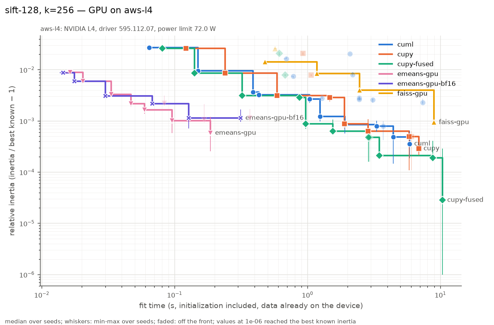

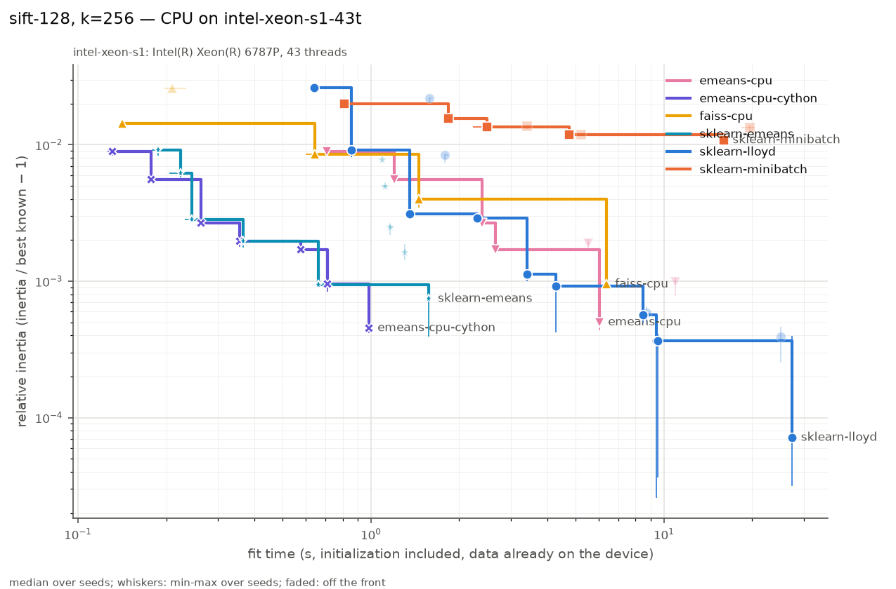

| implementation | device | ≤ 0.01 | ≤ 0.003 | ≤ 0.001 | best reached |
|---|---|---|---|---|---|
| emeans-cpu-cython | CPU | 0.13 s | 0.26 s | 0.71 s | 4.5e-04 |
| sklearn-emeans | CPU | 0.19 s | 0.24 s | 0.66 s | 7.4e-04 |
| faiss-cpu | CPU | 0.64 s | 6.35 s | 6.35 s | 9.5e-04 |
| emeans-cpu | CPU | 0.71 s | 2.39 s | 6.01 s | 5.0e-04 |
| sklearn-lloyd | CPU | 0.86 s | 2.30 s | 4.27 s | 7.1e-05 |
| sklearn-minibatch | CPU | – | – | – | 1.1e-02 |
| emeans-gpu-bf16 | GPU | 0.01 s | 0.07 s | – | 1.1e-03 |
| emeans-gpu | GPU | 0.02 s | 0.05 s | 0.19 s | 5.8e-04 |
| cupy-fused | GPU | 0.14 s | 0.87 s | 0.97 s | 2.8e-05 |
| cuml | GPU | 0.15 s | 1.03 s | 1.91 s | 3.6e-04 |
| cupy | GPU | 0.24 s | 1.46 s | 1.90 s | 2.9e-04 |
| faiss-gpu | GPU | 1.18 s | 8.95 s | 8.95 s | 9.4e-04 |

### sift-128, k=1024

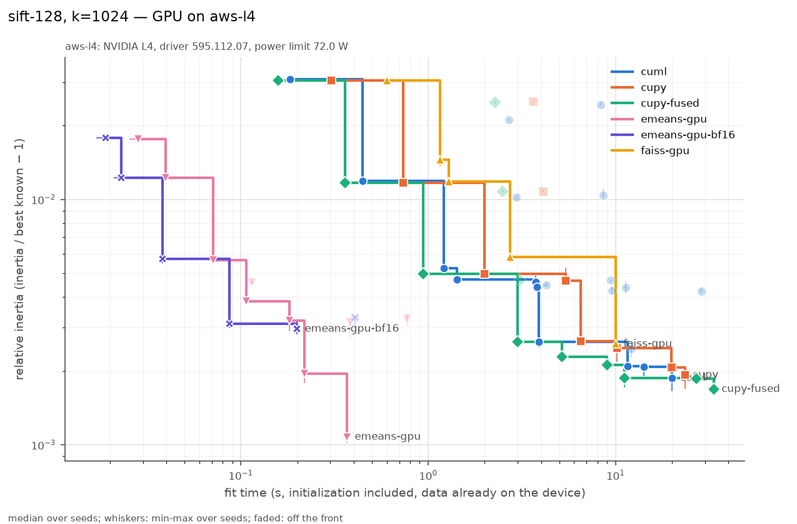

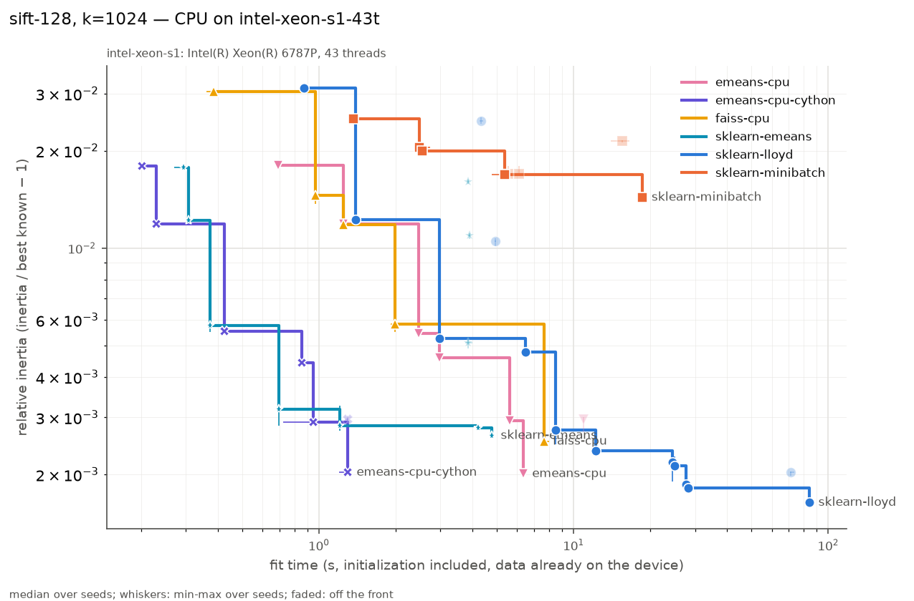

| implementation | device | ≤ 0.01 | ≤ 0.003 | ≤ 0.001 | best reached |
|---|---|---|---|---|---|
| sklearn-emeans | CPU | 0.37 s | 1.21 s | – | 2.6e-03 |
| emeans-cpu-cython | CPU | 0.43 s | 0.95 s | – | 2.0e-03 |
| faiss-cpu | CPU | 1.99 s | 7.63 s | – | 2.5e-03 |
| emeans-cpu | CPU | 2.46 s | 5.60 s | – | 2.0e-03 |
| sklearn-lloyd | CPU | 2.97 s | 8.48 s | – | 1.6e-03 |
| sklearn-minibatch | CPU | – | – | – | 1.4e-02 |
| emeans-gpu-bf16 | GPU | 0.04 s | 0.20 s | – | 3.0e-03 |
| emeans-gpu | GPU | 0.07 s | 0.22 s | – | 1.1e-03 |
| cupy-fused | GPU | 0.94 s | 3.00 s | – | 1.7e-03 |
| cuml | GPU | 1.21 s | 3.89 s | – | 1.9e-03 |
| cupy | GPU | 2.00 s | 6.49 s | – | 1.9e-03 |
| faiss-gpu | GPU | 2.74 s | 10.00 s | – | 2.6e-03 |

## glove-200

1,183,514 × 200: ann-benchmarks glove-200-angular (train). GloVe word vectors as published: unnormalized (norms ~6.2 +- 1.1).

### glove-200, k=256

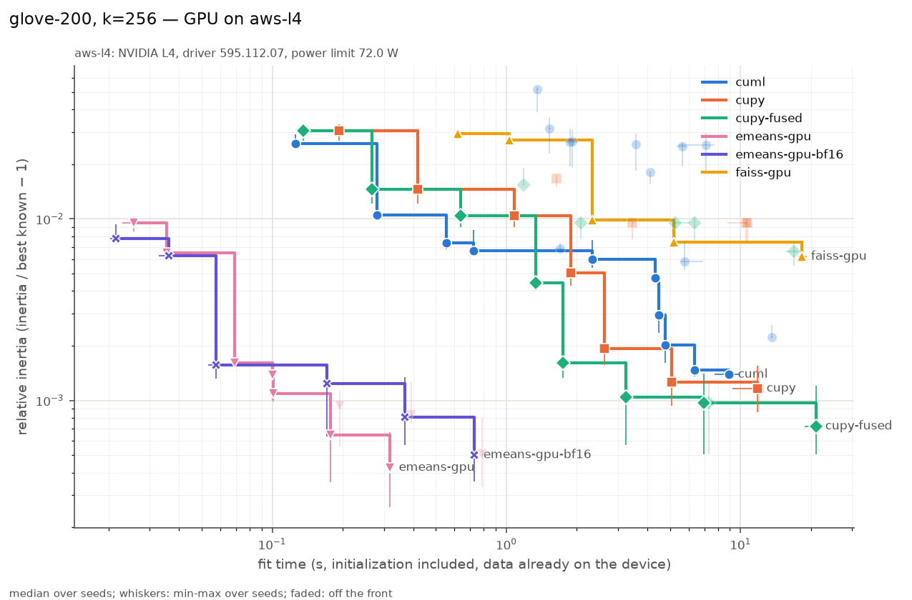

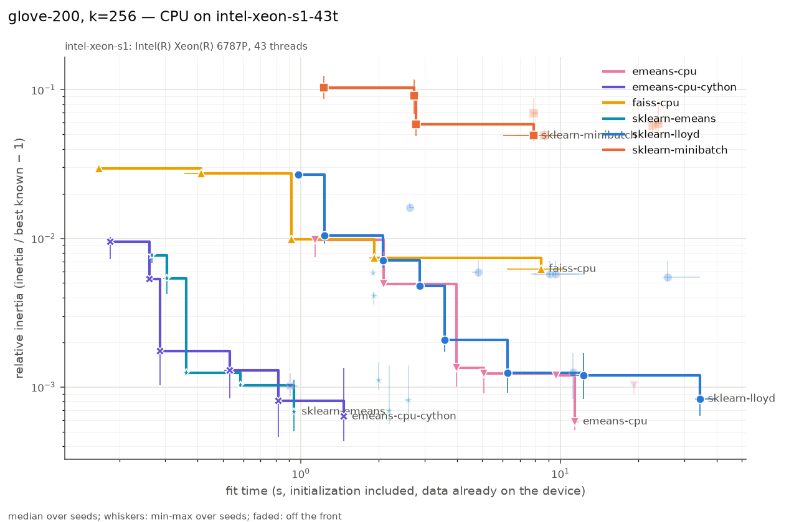

| implementation | device | ≤ 0.01 | ≤ 0.003 | ≤ 0.001 | best reached |
|---|---|---|---|---|---|
| emeans-cpu-cython | CPU | 0.18 s | 0.29 s | 0.82 s | 6.3e-04 |
| sklearn-emeans | CPU | 0.27 s | 0.36 s | 0.94 s | 6.8e-04 |
| faiss-cpu | CPU | 0.92 s | – | – | 6.2e-03 |
| emeans-cpu | CPU | 1.14 s | 3.99 s | 11 s | 5.8e-04 |
| sklearn-lloyd | CPU | 2.07 s | 3.59 s | 35 s | 8.3e-04 |
| sklearn-minibatch | CPU | – | – | – | 4.9e-02 |
| emeans-gpu-bf16 | GPU | 0.02 s | 0.06 s | 0.37 s | 5.0e-04 |
| emeans-gpu | GPU | 0.03 s | 0.07 s | 0.18 s | 4.3e-04 |
| cuml | GPU | 0.56 s | 4.47 s | – | 1.4e-03 |
| cupy-fused | GPU | 1.33 s | 1.74 s | 6.95 s | 7.2e-04 |
| cupy | GPU | 1.88 s | 2.62 s | – | 1.2e-03 |
| faiss-gpu | GPU | 2.33 s | – | – | 6.2e-03 |

### glove-200, k=1024

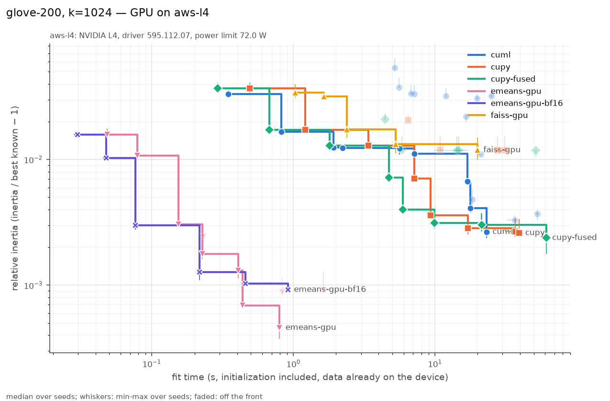

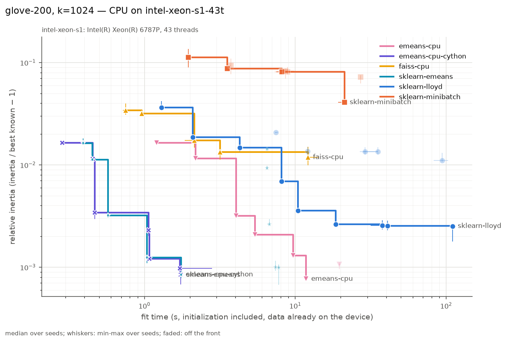

| implementation | device | ≤ 0.01 | ≤ 0.003 | ≤ 0.001 | best reached |
|---|---|---|---|---|---|
| emeans-cpu-cython | CPU | 0.47 s | 1.06 s | 1.72 s | 8.5e-04 |
| sklearn-emeans | CPU | 0.57 s | 1.04 s | 1.75 s | 8.4e-04 |
| emeans-cpu | CPU | 4.06 s | 5.40 s | 12 s | 7.7e-04 |
| sklearn-lloyd | CPU | 8.10 s | 18 s | – | 2.5e-03 |
| faiss-cpu | CPU | – | – | – | 1.2e-02 |
| sklearn-minibatch | CPU | – | – | – | 4.1e-02 |
| emeans-gpu-bf16 | GPU | 0.08 s | 0.22 s | 0.91 s | 9.2e-04 |
| emeans-gpu | GPU | 0.15 s | 0.23 s | 0.44 s | 4.6e-04 |
| cupy-fused | GPU | 4.74 s | 61 s | – | 2.4e-03 |
| cupy | GPU | 7.13 s | 17 s | – | 2.6e-03 |
| cuml | GPU | 17 s | 23 s | – | 2.7e-03 |
| faiss-gpu | GPU | – | – | – | 1.2e-02 |

## clip-512

1,000,000 × 512: Qdrant/wolt-food-clip-ViT-B-32-embeddings, first 1M rows (parts 00-19). L2-normalized CLIP ViT-B/32 image embeddings; many exact duplicates (~23% of the first 200k rows), kept on purpose.

### clip-512, k=256

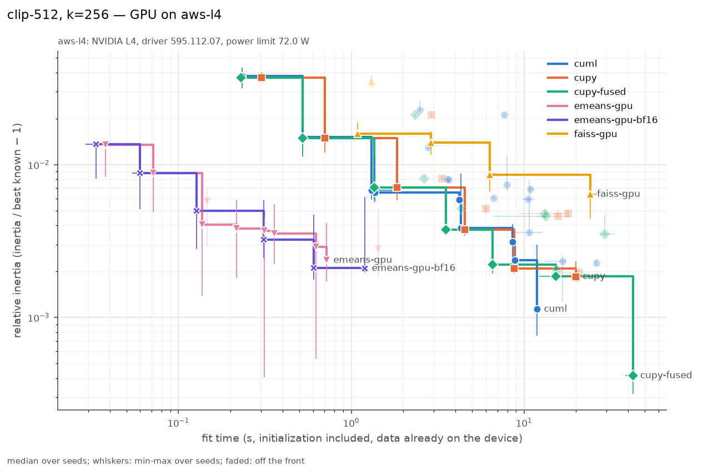

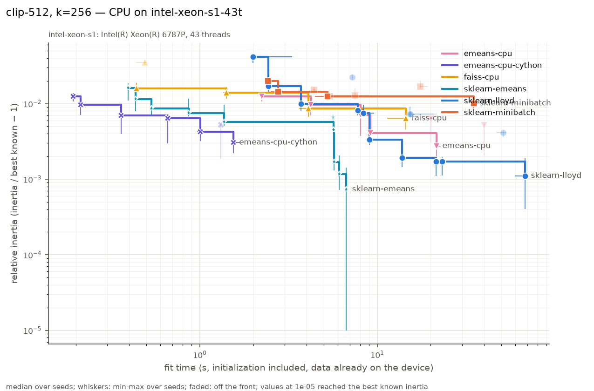

| implementation | device | ≤ 0.01 | ≤ 0.003 | ≤ 0.001 | best reached |
|---|---|---|---|---|---|
| emeans-cpu-cython | CPU | 0.21 s | – | – | 3.1e-03 |
| sklearn-emeans | CPU | 0.53 s | 5.71 s | 6.68 s | 7.4e-04 |
| sklearn-lloyd | CPU | 3.71 s | 14 s | – | 1.1e-03 |
| faiss-cpu | CPU | 4.10 s | – | – | 6.4e-03 |
| emeans-cpu | CPU | 4.22 s | 22 s | – | 2.8e-03 |
| sklearn-minibatch | CPU | – | – | – | 1.0e-02 |
| emeans-gpu-bf16 | GPU | 0.06 s | 0.61 s | – | 2.1e-03 |
| emeans-gpu | GPU | 0.07 s | 0.62 s | – | 2.4e-03 |
| cuml | GPU | 1.31 s | 8.86 s | – | 1.1e-03 |
| cupy-fused | GPU | 1.36 s | 6.58 s | 43 s | 4.2e-04 |
| cupy | GPU | 1.84 s | 8.79 s | – | 1.9e-03 |
| faiss-gpu | GPU | 6.34 s | – | – | 6.4e-03 |

### clip-512, k=1024

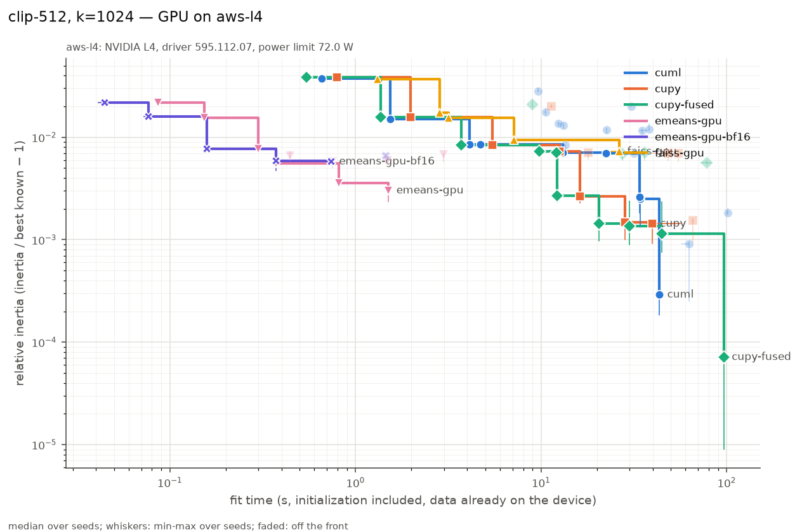

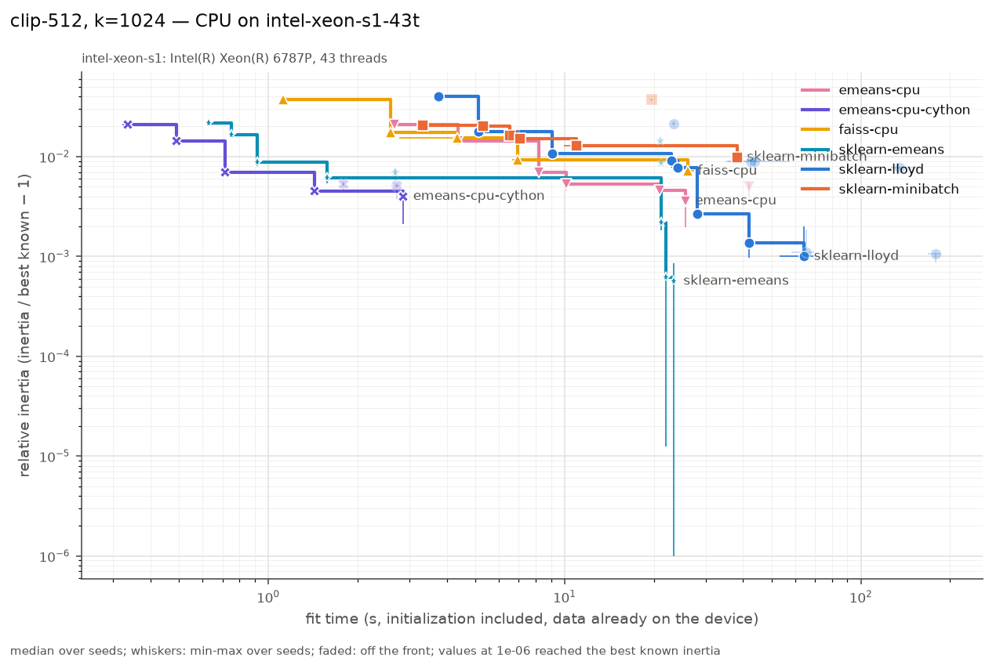

| implementation | device | ≤ 0.01 | ≤ 0.003 | ≤ 0.001 | best reached |
|---|---|---|---|---|---|
| emeans-cpu-cython | CPU | 0.72 s | – | – | 4.0e-03 |
| sklearn-emeans | CPU | 0.92 s | 21 s | 22 s | 5.6e-04 |
| faiss-cpu | CPU | 6.92 s | – | – | 7.1e-03 |
| emeans-cpu | CPU | 8.19 s | – | – | 3.6e-03 |
| sklearn-lloyd | CPU | 23 s | 28 s | 64 s | 1.0e-03 |
| sklearn-minibatch | CPU | 38 s | – | – | 9.8e-03 |
| emeans-gpu-bf16 | GPU | 0.16 s | – | – | 5.8e-03 |
| emeans-gpu | GPU | 0.30 s | – | – | 3.0e-03 |
| cupy-fused | GPU | 3.72 s | 12 s | 96 s | 7.2e-05 |
| cuml | GPU | 4.10 s | 34 s | 43 s | 2.9e-04 |
| cupy | GPU | 5.48 s | 16 s | – | 1.4e-03 |
| faiss-gpu | GPU | 7.16 s | – | – | 7.2e-03 |

## susy

5,000,000 × 18: UCI SUSY (id 279), label column dropped. 18 kinematic features of particle collisions, as published (already roughly normalized: feature std 0.2 to 1.0).

### susy, k=256

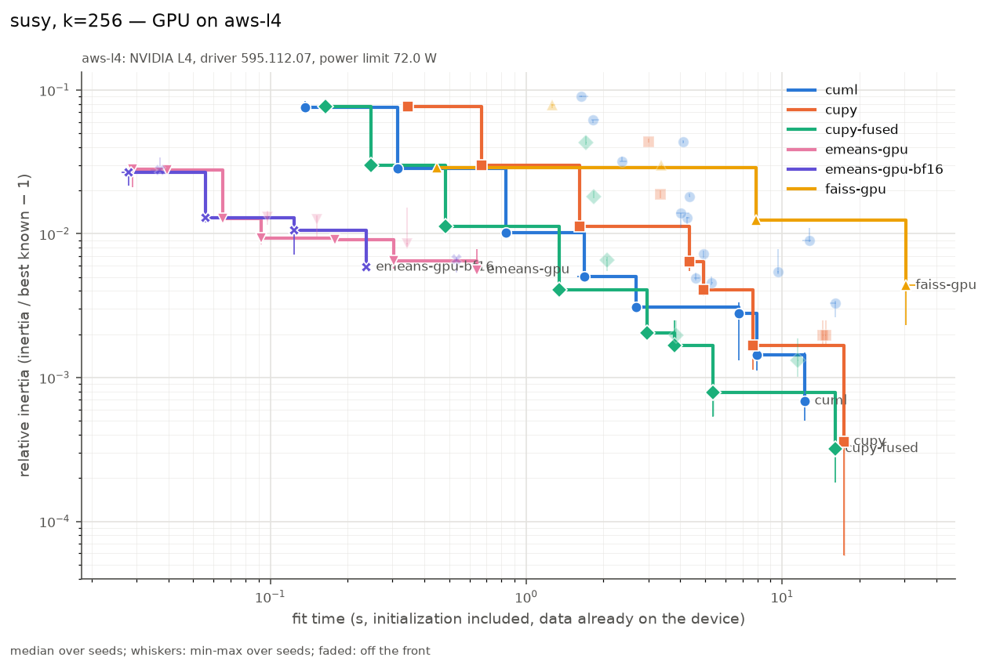

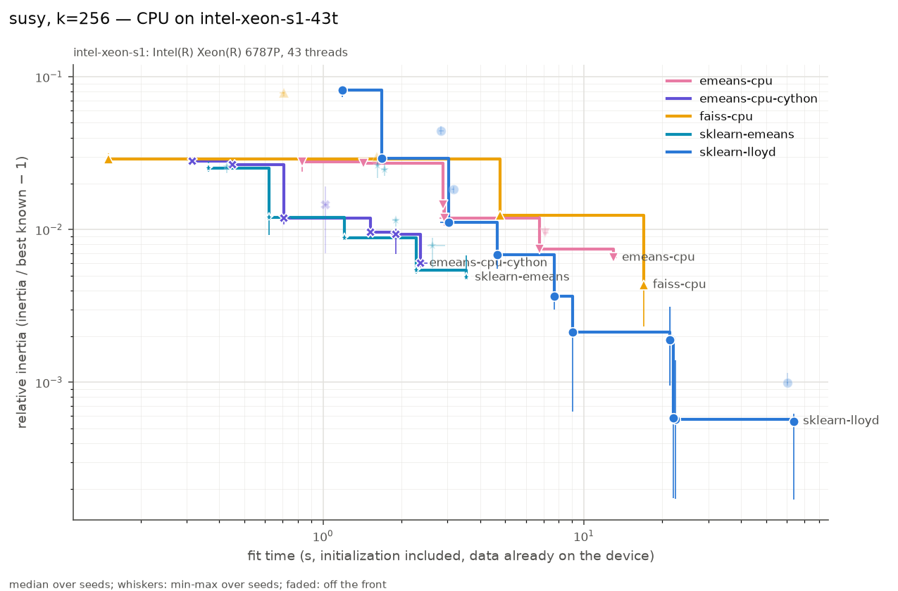

| implementation | device | ≤ 0.01 | ≤ 0.003 | ≤ 0.001 | best reached |
|---|---|---|---|---|---|
| sklearn-emeans | CPU | 1.21 s | – | – | 4.9e-03 |
| emeans-cpu-cython | CPU | 1.52 s | – | – | 6.0e-03 |
| sklearn-lloyd | CPU | 4.65 s | 9.06 s | 22 s | 5.6e-04 |
| emeans-cpu | CPU | 6.76 s | – | – | 6.5e-03 |
| faiss-cpu | CPU | 17 s | – | – | 4.3e-03 |
| emeans-gpu | GPU | 0.09 s | – | – | 5.6e-03 |
| emeans-gpu-bf16 | GPU | 0.24 s | – | – | 5.9e-03 |
| cupy-fused | GPU | 1.34 s | 2.97 s | 5.37 s | 3.2e-04 |
| cuml | GPU | 1.69 s | 6.75 s | 12 s | 6.9e-04 |
| cupy | GPU | 4.35 s | 7.71 s | 17 s | 3.6e-04 |
| faiss-gpu | GPU | 30 s | – | – | 4.4e-03 |

### susy, k=1024

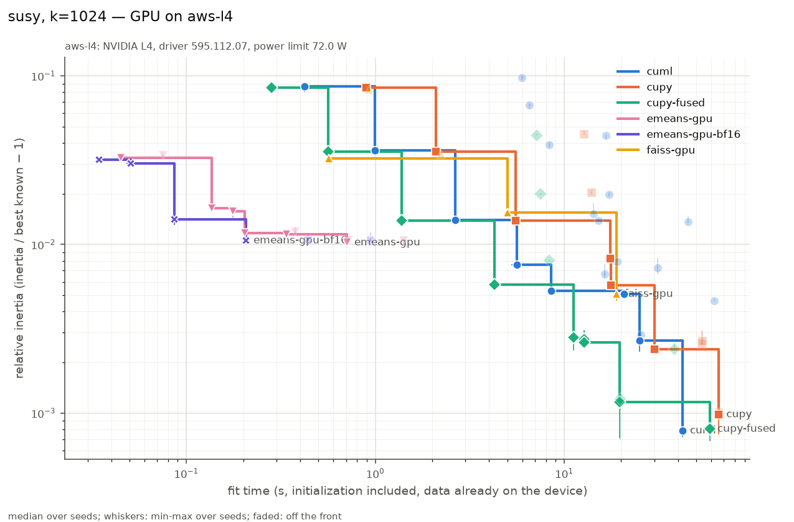

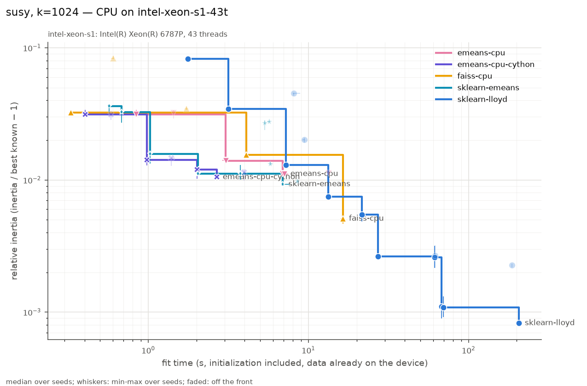

| implementation | device | ≤ 0.01 | ≤ 0.003 | ≤ 0.001 | best reached |
|---|---|---|---|---|---|
| sklearn-emeans | CPU | 6.91 s | – | – | 9.3e-03 |
| sklearn-lloyd | CPU | 13 s | 27 s | 207 s | 8.3e-04 |
| faiss-cpu | CPU | 16 s | – | – | 5.1e-03 |
| emeans-cpu | CPU | – | – | – | 1.1e-02 |
| emeans-cpu-cython | CPU | – | – | – | 1.1e-02 |
| cupy-fused | GPU | 4.28 s | 11 s | 59 s | 8.0e-04 |
| cuml | GPU | 5.61 s | 25 s | 42 s | 7.9e-04 |
| cupy | GPU | 18 s | 30 s | 66 s | 9.8e-04 |
| faiss-gpu | GPU | 19 s | – | – | 5.1e-03 |
| emeans-gpu | GPU | – | – | – | 1.0e-02 |
| emeans-gpu-bf16 | GPU | – | – | – | 1.1e-02 |

## year-msd

515,345 × 90: UCI YearPredictionMSD (id 203), year dropped. 12 timbre averages and 78 timbre covariances, standardized per feature: raw feature std ranges from 4.4 to 1750, which would make Euclidean distances depend on a handful of covariance features.

### year-msd, k=256

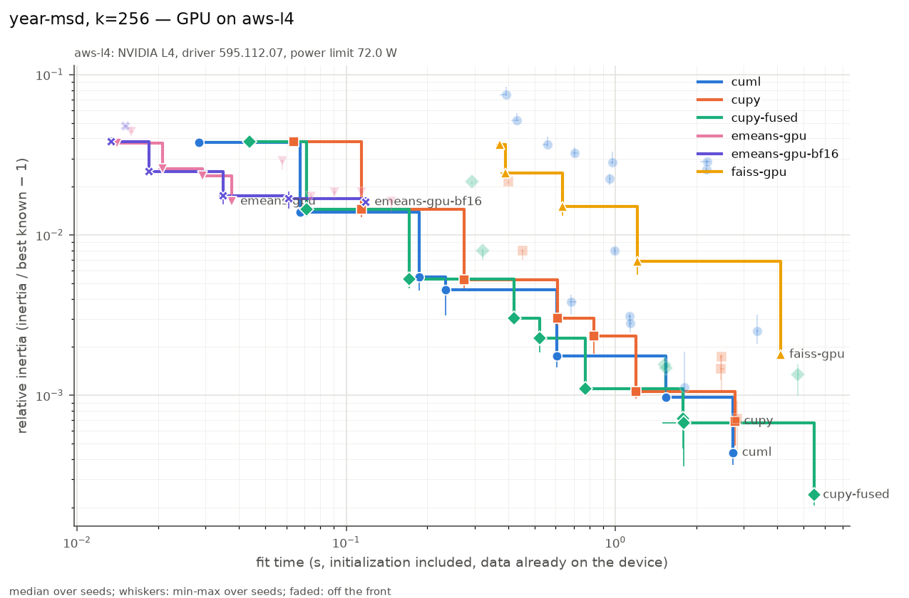

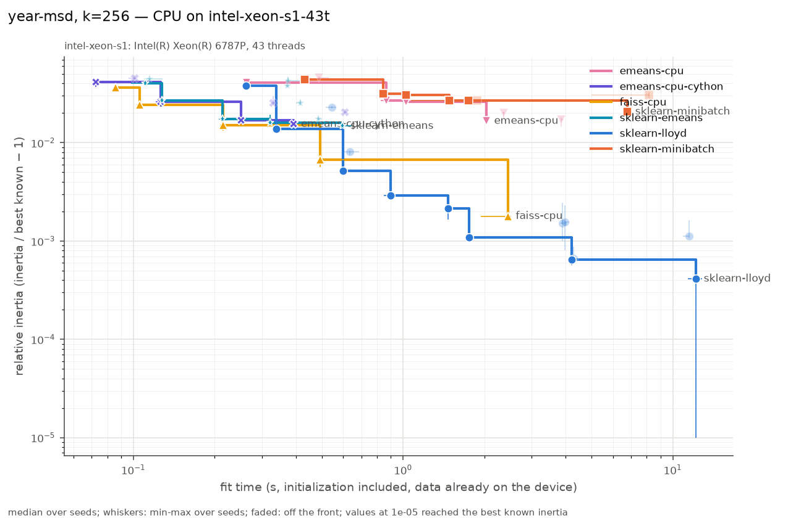

| implementation | device | ≤ 0.01 | ≤ 0.003 | ≤ 0.001 | best reached |
|---|---|---|---|---|---|
| faiss-cpu | CPU | 0.49 s | 2.45 s | – | 1.8e-03 |
| sklearn-lloyd | CPU | 0.60 s | 0.90 s | 4.21 s | 4.1e-04 |
| emeans-cpu | CPU | – | – | – | 1.7e-02 |
| emeans-cpu-cython | CPU | – | – | – | 1.5e-02 |
| sklearn-emeans | CPU | – | – | – | 1.5e-02 |
| sklearn-minibatch | CPU | – | – | – | 2.1e-02 |
| cupy-fused | GPU | 0.17 s | 0.52 s | 1.79 s | 2.4e-04 |
| cuml | GPU | 0.19 s | 0.61 s | 1.54 s | 4.4e-04 |
| cupy | GPU | 0.27 s | 0.83 s | 2.78 s | 6.9e-04 |
| faiss-gpu | GPU | 1.21 s | 4.10 s | – | 1.8e-03 |
| emeans-gpu | GPU | – | – | – | 1.6e-02 |
| emeans-gpu-bf16 | GPU | – | – | – | 1.6e-02 |

### year-msd, k=1024

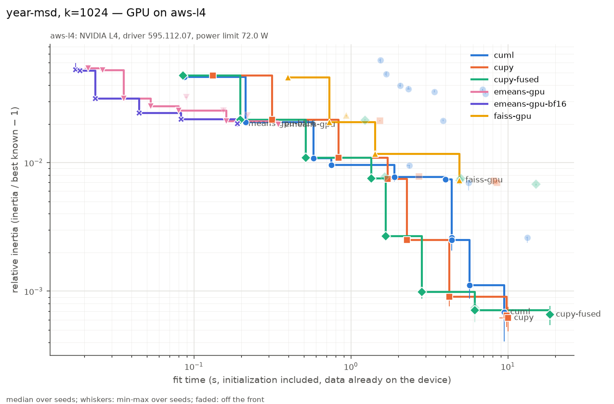

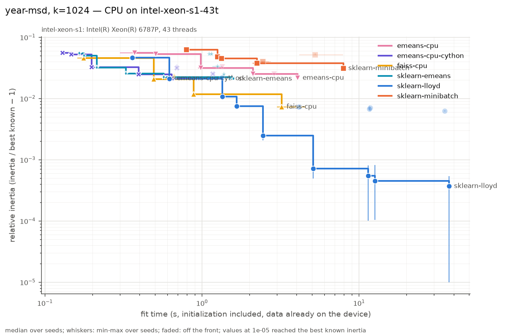

| implementation | device | ≤ 0.01 | ≤ 0.003 | ≤ 0.001 | best reached |
|---|---|---|---|---|---|
| sklearn-lloyd | CPU | 1.66 s | 2.45 s | 5.09 s | 3.7e-04 |
| faiss-cpu | CPU | 3.21 s | – | – | 7.3e-03 |
| emeans-cpu | CPU | – | – | – | 2.2e-02 |
| emeans-cpu-cython | CPU | – | – | – | 2.1e-02 |
| sklearn-emeans | CPU | – | – | – | 2.1e-02 |
| sklearn-minibatch | CPU | – | – | – | 3.1e-02 |
| cuml | GPU | 0.75 s | 4.37 s | 9.48 s | 6.9e-04 |
| cupy-fused | GPU | 1.34 s | 1.67 s | 2.84 s | 6.6e-04 |
| cupy | GPU | 1.72 s | 2.27 s | 4.24 s | 6.2e-04 |
| faiss-gpu | GPU | 4.91 s | – | – | 7.3e-03 |
| emeans-gpu | GPU | – | – | – | 2.0e-02 |
| emeans-gpu-bf16 | GPU | – | – | – | 2.0e-02 |

## road-network

4,348,740 × 3: UCI 3D Road Network, North Jutland (id 246), OSM id dropped, 10x oversampled. 434,874 GPS points along roads (longitude, latitude, altitude), projected to local kilometers (equirectangular around the mean latitude, altitude in km), so that distances are physical: in raw units altitude in meters would weigh 30x more than longitude in degrees. Oversampled 10x: each point and 9 copies with isotropic Gaussian jitter of 5 m (about half a road's width; median nearest-neighbor spacing is 16 m), seed 0.

### road-network, k=256

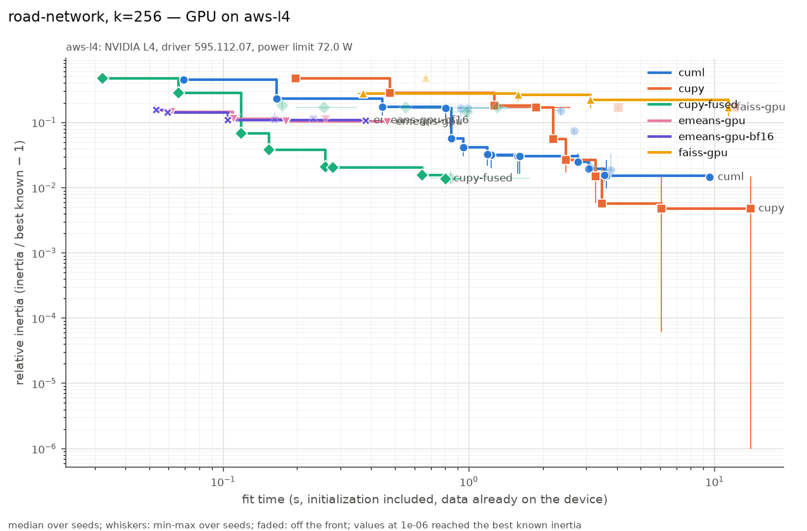

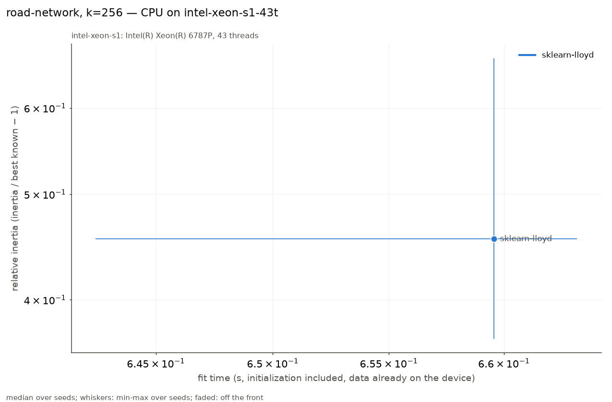

*CPU (partial: 3/162 fits).*

| implementation | device | ≤ 0.01 | ≤ 0.003 | ≤ 0.001 | best reached |
|---|---|---|---|---|---|
| sklearn-lloyd | CPU | – | – | – | 4.5e-01 |
| cupy | GPU | 3.48 s | – | – | 4.8e-03 |
| cuml | GPU | – | – | – | 1.4e-02 |
| cupy-fused | GPU | – | – | – | 1.4e-02 |
| emeans-gpu | GPU | – | – | – | 1.0e-01 |
| emeans-gpu-bf16 | GPU | – | – | – | 1.1e-01 |
| faiss-gpu | GPU | – | – | – | 1.7e-01 |

### road-network, k=1024

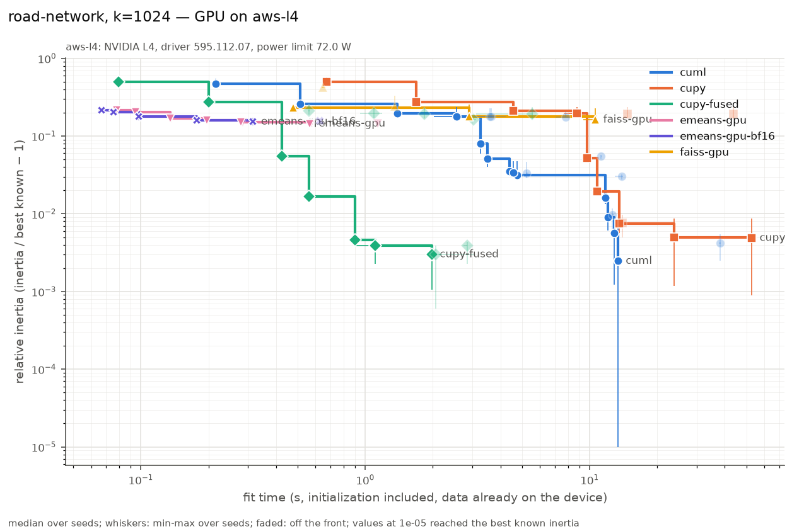

*CPU on `intel-xeon-s1-43t`: no results yet.*

| implementation | device | ≤ 0.01 | ≤ 0.003 | ≤ 0.001 | best reached |
|---|---|---|---|---|---|
| cupy-fused | GPU | 0.90 s | 1.98 s | – | 3.0e-03 |
| cuml | GPU | 12 s | 13 s | – | 2.5e-03 |
| cupy | GPU | 14 s | – | – | 4.9e-03 |
| emeans-gpu | GPU | – | – | – | 1.4e-01 |
| emeans-gpu-bf16 | GPU | – | – | – | 1.5e-01 |
| faiss-gpu | GPU | – | – | – | 1.6e-01 |
